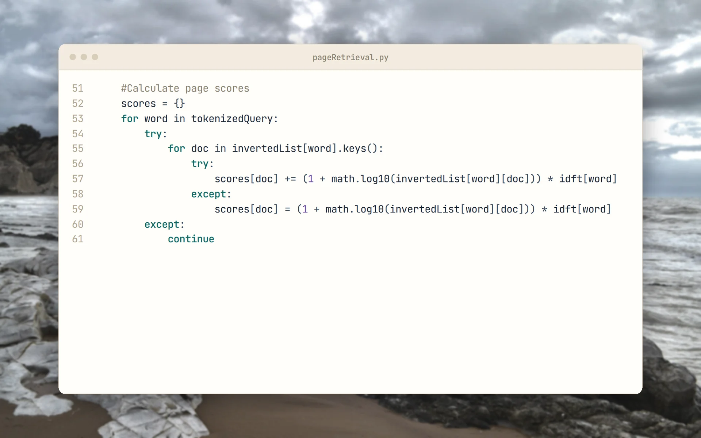
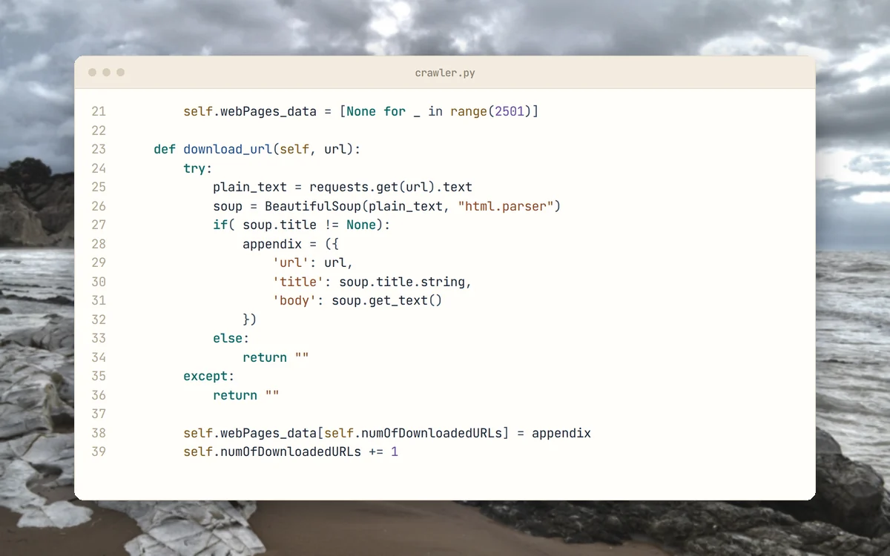
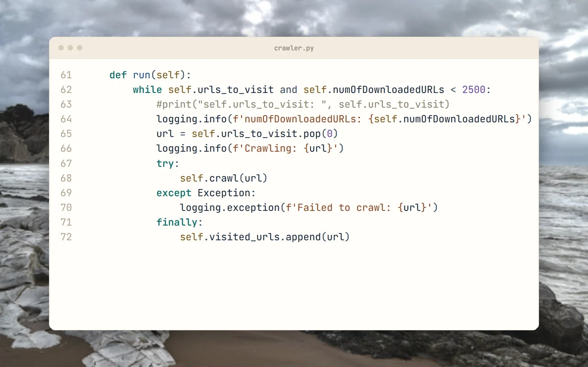
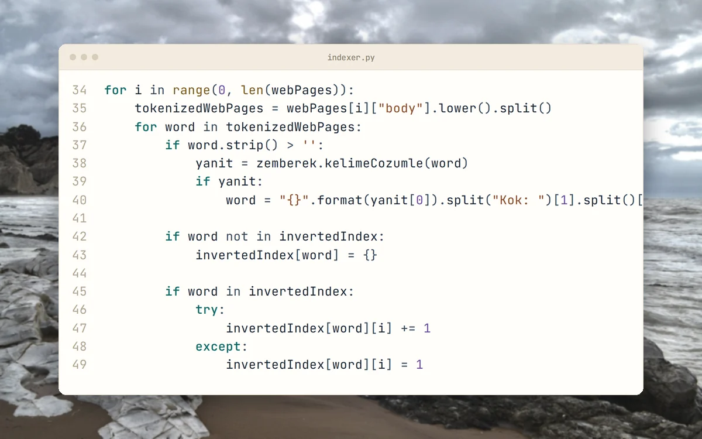
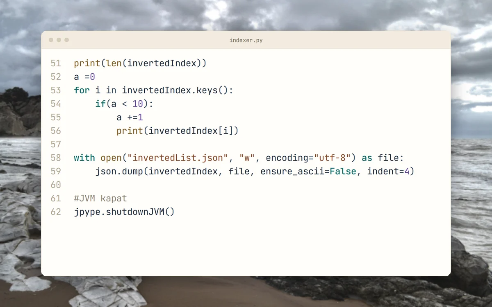

<p align="center">
  <picture>
    <source media="(prefers-color-scheme: dark)" srcset="docs/brand/svg/ir-system-logo-on-dark.svg">
    
  </picture>
</p>

<h1 align="center">Crawl Turkish COVID‑19 pages.<br>Search them with TF‑IDF.</h1>

<p align="center">
  Coursework from 2021: a crawler, an inverted index and TF-IDF retrieval.<br>
  <b>Python with Zemberek stemming for Turkish through JPype.</b>
</p>

<p align="center">
  
  
  
  
  <a href="https://github.com/mertkayacs/InformatiionRetrievalSystem"></a>
</p>

<p align="center">
  <a href="#quick-start"></a>
  <a href="crawler.py"></a>
  <a href="pageRetrieval.py"></a>
</p>

<p align="center">
  <picture>
    <source media="(prefers-color-scheme: dark)" srcset="docs/assets/readme/hero-dark.webp">
    
  </picture>
</p>

Information Retrieval System is a small search engine for Turkish COVID-19 web content, written as coursework in 2021. It crawls pages, builds an inverted index with Turkish stemming and ranks matches for a query typed at the console. The whole program is three Python scripts plus the Zemberek library jar.

---

## Why Information Retrieval System

The three stages mirror the classic information retrieval pipeline.

|  |  |
|---|---|
|  **Crawl** | crawler.py runs one crawl from each of four Turkish COVID-19 pages. Each crawl stops at 2,500 pages and appends them to webPages.json. |
|  **Index** | indexer.py strips punctuation, stems words with Zemberek and writes term frequencies per page to invertedList.json. |
|  **Rank** | pageRetrieval.py scores pages with TF-IDF, using (1 + log10 tf) times log10(N / df), and prints the matching URLs. |

## A quick tour

<table>
  <tr>
    <td width="50%" valign="top">
      <picture>
        <source media="(prefers-color-scheme: dark)" srcset="docs/assets/readme/tour/download-dark.webp">
        
      </picture>
      <h3>Download a page</h3>
      A page is fetched, its title and text are kept, and it counts toward the cap.
    </td>
    <td width="50%" valign="top">
      <picture>
        <source media="(prefers-color-scheme: dark)" srcset="docs/assets/readme/tour/loop-dark.webp">
        
      </picture>
      <h3>Crawl loop</h3>
      URLs are visited until the queue is empty or 2,500 pages are stored.
    </td>
  </tr>
  <tr>
    <td width="50%" valign="top">
      <picture>
        <source media="(prefers-color-scheme: dark)" srcset="docs/assets/readme/tour/index-dark.webp">
        
      </picture>
      <h3>Inverted index</h3>
      Each word is stemmed with Zemberek and counted per page.
    </td>
    <td width="50%" valign="top">
      <picture>
        <source media="(prefers-color-scheme: dark)" srcset="docs/assets/readme/tour/save-dark.webp">
        
      </picture>
      <h3>Save the index</h3>
      The inverted index is written to invertedList.json and the Zemberek JVM is shut down.
    </td>
  </tr>
</table>

<p align="center"><sub>Code cards show the files as they are in the repository.</sub></p>

## Features

- Requests and BeautifulSoup crawler with a cap of 2,500 pages per crawl.
- Turkish stemming through the Zemberek jar, called from Python with JPype.
- JSON files for storage, with no database.
- Console menu in Turkish for queries.

## Quick start

```sh
pip install jpype1 beautifulsoup4 requests
```

The JVM path is fixed in `indexer.py` and `pageRetrieval.py` (the `jpype.startJVM` call near the top of each). Point both at the JVM library on your machine and at the `zemberek-tum-2.0.jar` file in this repository. Then run the stages in order:

```sh
echo "[]" > webPages.json
python crawler.py
python indexer.py
python pageRetrieval.py
```

The crawler reads `webPages.json` at the end of each crawl, so create it first as shown.

### Requirements

- Python 3 and a JDK.
- The packages above.

## FAQ

<details>
<summary><b>Why does it need Java?</b></summary>

Zemberek, the Turkish morphological analyser, is a Java library. The scripts call it from Python through JPype.
</details>

<details>
<summary><b>How are results ranked?</b></summary>

By TF-IDF over the inverted index of stemmed words.
</details>

<details>
<summary><b>Why is the repository called InformatiionRetrievalSystem?</b></summary>

The name is the original coursework name and keeps its typo. The project is the Information Retrieval System.
</details>

<details>
<summary><b>Does the crawler still work?</b></summary>

The seeds are four pages from 2021, and some may have moved. The crawler has not been re-run for this README.
</details>

If Information Retrieval System is useful to you, a ⭐ helps other people find it.

Photos behind the screenshots are credited in [docs/assets/readme/CREDITS.md](docs/assets/readme/CREDITS.md).

[](https://github.com/mertkayacs/InformatiionRetrievalSystem)
